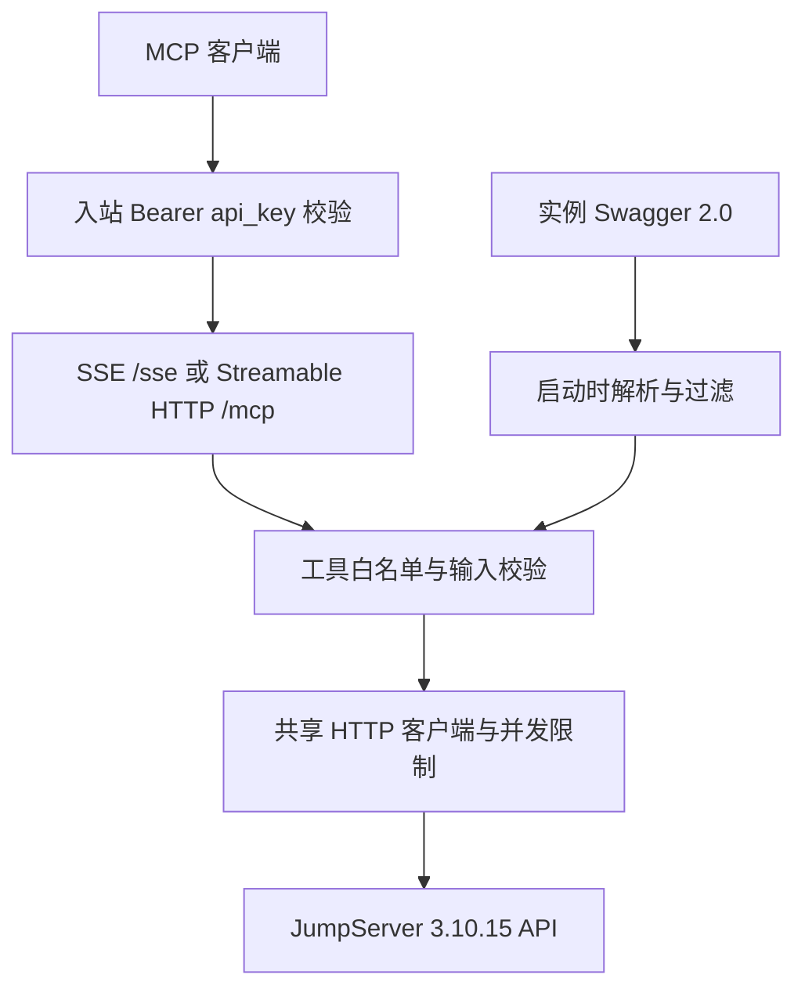

# 架构与执行流程

1. 启动时校验配置，以服务端凭证获取同源 Swagger；初始化失败则不就绪。
2. Swagger 2 使用 `basePath`；OpenAPI 3 使用首个 server 的路径。主机名始终来自管理员配置。
3. 合并路径级与操作级参数，解析本地引用；按 `path`、`query`、`body` 生成输入 schema。
4. 应用过滤策略。无法可靠表达的接口记录为 skipped；重名和数量超限使初始化失败。
5. 每次 MCP HTTP 请求先校验独立入站密钥，会话 ID 不作为认证依据。
6. 执行时仅允许已注册工具；验证类型与必填项，编码路径值，以服务端凭证调用上游。
7. 连接复用，限制排队与请求总时间，不重试；HTTP 非 2xx、超时与超限返回 `isError=true`。

本版不持久化资产、令牌或会话，不提供动态配置修改接口。Swagger 和工具目录在进程生命周期内固定，配置或权限变化后重启。

共享 api_token 意味着所有 MCP 客户端使用同一个 JumpServer 身份。需要逐人审计时，分别部署网关与上游账号；后续版本再设计用户映射。日志不记录凭证、工具参数、上游错误响应体；默认关闭 Uvicorn 访问日志以避免 SSE session_id 出现在日志中。
